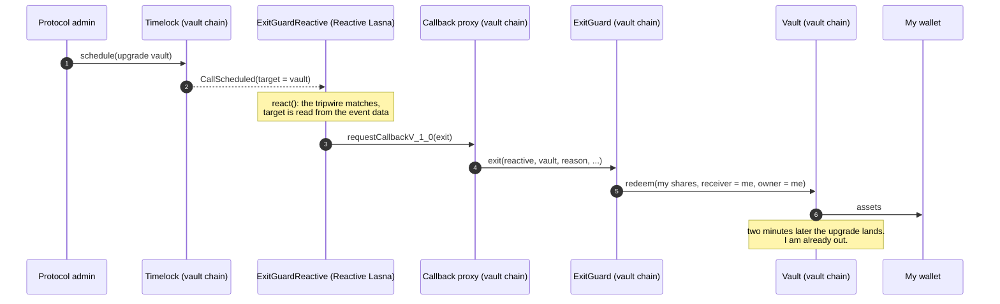

# ExitGuard

**The missing half of the timelock. Protocols delay their changes so that depositors can leave first. ExitGuard is the part that actually leaves: when the contract holding your money is about to change, it takes you out and lets you decide later.**

Built for the [Reactive Omni Buildathon](https://dorahacks.io/hackathon/reactive-omni-buildathon), track *Set It and Forget It*.

[Live console](https://ankita-gajera.github.io/exitguard/) · [Live runs with every transaction hash](#live-deployment) · [Scan a vault you use](#who-can-change-my-vault)

## The problem it solves for me

Price alerts are easy to get. The risk I cannot watch around the clock is governance: an upgrade being queued, an owner changing, a proxy pointing at new code. Those are the moments a vault's risk changes, and they happen while I am asleep.

Careful protocols put such changes behind a timelock, a waiting period of hours or days, precisely so that depositors can leave before a change lands. That promise only holds if somebody is watching the timelock. Nobody is.

The rule I wanted automated is simple:

> If the contract holding my deposit is about to change, get me out first. I will read the change in the morning and go back in if I like it.

ExitGuard is that rule, running on Reactive Network with no bot, no server and no keys online.

## What happens

1. I deposit into an ERC-4626 vault as usual. The shares stay in my wallet.
2. I give my `ExitGuard` contract an allowance on those shares and arm it.
3. On Reactive Network, my `ExitGuardReactive` contract holds **tripwires**: governance events on any supported chain that should make me leave.
4. A tripwire fires, for example the vault's timelock emits `CallScheduled` with the vault as target.
5. Reactive Network calls `react()`; the reactive contract requests a callback; the callback proxy calls `ExitGuard.exit()`.
6. The guard redeems my shares straight to my wallet (or a cold wallet I chose), while the vault still runs the old code.

The warning does not have to come from the vault's own chain. A tripwire can watch the same protocol's deployment on another chain: when that one is paused, I leave this one before the trouble spreads. [Both triggers have run live](#live-deployment).



## Who can change my vault?

Before watching a vault you have to know what to watch. The [console](https://ankita-gajera.github.io/exitguard/) answers that for any address: paste a vault, and it reads who can change it, how much warning you would get, and which tripwires ExitGuard would lay. It only reads (a few `eth_call` and `eth_getStorageAt` requests to a public RPC), needs no wallet, and works on Ethereum, Base, Arbitrum and BNB Chain as well as the testnets.

What it printed for four well-known vaults on Ethereum on 12 November 2026:

| Vault | What the scan read |
|---|---|
| Savings Dai (`sDAI`) | No upgradeable proxy and no owner. Nothing can change it through the usual doors, so there is nothing to watch. |
| Staked USDe (`sUSDe`) | The owner is a timelock with a delay of 24 hours. Tripwires: `watchTimelock`, `watchOwnership`. |
| Steakhouse USDC (`steakUSDC`) | A MetaMorpho vault. Changes that loosen its risk rules wait 7 days in the vault's own timelock (`watchMetaMorpho`). Its owner, a 5-of-10 Safe, can change the fee, the curator and the allocators without delay (`watchSafe`). |
| Savings USDS (`sUSDS`) | An upgradeable proxy whose upgrade right is granted by custom logic the scan cannot read. It says "unknown" rather than guess, and suggests the backstop `watchProxy`. |

This is a reading of standard interfaces, not an audit: ERC-1967 proxy slots, `owner()`, OpenZeppelin and Compound timelocks, Safe, MetaMorpho. Powers granted through roles or custom logic are invisible to it, and the page says so under every result.

## Why this needs Reactive Network

The trigger is an event on one contract (a timelock, a proxy, a sister deployment on another chain). The action is a transaction on a different contract, possibly on a different chain. Nothing on-chain connects the two by itself; the usual answer is an off-chain bot with a hot key. Here the reactive contract is the bot: it subscribes to the events, decides in Solidity, and asks for the callback.

The reactive contract does real work beyond forwarding. A subscription can only filter on indexed topics, but a timelock puts the *target* of a queued call in the event's data. `ExitGuardReactive` therefore matches each log against three optional topic filters and one optional 32-byte data word, so "the timelock queued something against **my** vault" is distinguished from "the timelock queued something".

## What is in the box

| Contract | Chain | Role |
|---|---|---|
| [`ExitGuardReactive`](src/ExitGuardReactive.sol) | Reactive Network | Holds the tripwires, reacts to matching events, requests the exit. |
| [`ExitGuard`](src/ExitGuard.sol) | Where the vault is | Receives the callback and redeems the owner's shares to the owner's receiver. |
| [`BoundedCall`](src/libraries/BoundedCall.sol) | (library) | Calls into the vault with a gas budget and capped return data. |
| [`src/demo/*`](src/demo) | Testnet only | Test dollars, an upgradeable vault behind a timelock, a V2 that freezes withdrawals, and a sister deployment for another chain. |
| [`docs/scan.js`](docs/scan.js) | In the browser | The vault scan: who can change a vault, and which tripwires fit it. |

### Tripwires that come ready-made

| Call | Fires on | Reason code |
|---|---|---|
| `watchTimelock(chain, timelock, target, vault)` | OpenZeppelin `TimelockController.CallScheduled` whose target is `target` | 1 |
| `watchProxy(chain, proxy, vault)` | ERC-1967 `Upgraded` and `AdminChanged` | 2, 3 |
| `watchOwnership(chain, ownable, vault)` | `OwnershipTransferStarted` and `OwnershipTransferred` | 4, 5 |
| `watchPause(chain, pausable, vault)` | `Paused`, typically on a related contract or another chain | 6 |
| `watchCompoundTimelock(chain, timelock, target, vault)` | Compound-style `Timelock.QueueTransaction` against `target` (Governor Alpha and Bravo, and their forks) | 1 |
| `watchSafe(chain, safe, vault)` | Safe `AddedOwner`, `RemovedOwner` and `ChangedThreshold`: the multisig that controls the vault changes who signs, or how many must | 7 |
| `watchMetaMorpho(chain, vault, includeCaps)` | MetaMorpho `SubmitTimelock`, `SubmitGuardian`, `SubmitMarketRemoval` (and `SubmitCap` if asked): a change to the vault's risk rules enters its timelock. Also `SetCurator`. | 8, 9 |
| `addTripwire(tripwire)` | Any event, with topic and data-word filters of your choice | yours |

The event signatures of the last three come from the projects' own sources, and the tests check the topics against them.

### The drill

A safety tool that fails silently is worse than none. `ExitGuard.requestDrill(vault)` emits an event; the reactive contract answers through the same path a real exit would take; the guard emits `DrillPassed` with the round-trip time in seconds and blocks, and the number of tripwires guarding that vault. Nothing is redeemed. If a drill is not answered, something is unfunded or unlinked, and I know before it matters.

In the console, a passed drill is followed by an **exit rehearsal**: the drill's own delivery is replayed as a simulation with the exit in its place, which answers the question the drill cannot, namely whether the redemption fits in the callback's gas on this chain today. The [first live run](#the-first-live-run-failed-and-what-it-changed) is why it exists.

## Built for a vault that may have turned hostile

`exit()` runs at the exact moment the vault's code or owner is changing, so the guard treats the vault as untrusted:

- **Only my funds, only to my receiver.** A callback can only redeem the owner's shares to the receiver the owner configured. A forged or mistaken trigger costs yield and gas, never principal.
- **Two-factor callback authentication.** `onlyServiceProvider` (the caller is the callback proxy) and `onlyCallbackSender` (the request came from my reactive contract).
- **Bounded calls.** Every call into the vault copies at most one word of return data and at most 256 bytes of revert data. A vault cannot exhaust the callback's gas with a large blob.
- **Gas reserve.** 60,000 gas is kept back from the redemption, so a vault that burns everything still leaves room to record `ExitFailed`.
- **Never reverts because of the vault.** Failed callbacks are billed anyway; the guard records `ExitFailed` or `ExitSkipped` with a cause and stays armed, so the next tripwire or `exitNow()` can retry.
- **Cooldown.** One governance action often emits several watched events. The reactive contract requests at most one exit per vault per cooldown (five minutes by default).

## Try it

### 1. Tests

```bash
git clone https://github.com/Ankita-Gajera/exitguard && cd exitguard
forge install --no-git foundry-rs/forge-std@v1.17.0 OpenZeppelin/openzeppelin-contracts@v5.7.0 \
  OpenZeppelin/openzeppelin-contracts-upgradeable@v5.7.0 Reactive-Network/reactive-lib-omni
forge test
```

111 tests cover both contracts and the library at 100% of lines and branches, including fuzzing of the matcher, an end-to-end run against a real OpenZeppelin `TimelockController` and UUPS proxy, and exits triggered by look-alikes of a Safe, a Compound timelock and a MetaMorpho vault that emit the real events.

One of them, `test_WatchingOnlyTheProxyIsTooLate`, shows why the *early* tripwire matters: if you only watch `Upgraded`, the hostile code is already live when your exit arrives.

### 2. The whole story on your laptop, in one command

No testnet tokens needed. A small script plays the part of Reactive Network on a local anvil chain and runs the same deployment scripts used on the testnets.

```bash
cd tools && npm install && node local-demo.mjs
```

```text
6. The protocol's admin queues an upgrade of the vault in the timelock.
   [reactive] tripwire #0 fired for the vault (reason 1)
   [guard] position disarmed
   [guard] EXITED: 1000.0 shares redeemed for 1000.0 mUSD
   The vault still runs version 1.
   You: 1000.0 mUSD in your wallet, 0.0 vault shares
   Bob: 0.0 mUSD in his wallet, 1000.0 vault shares

7. Two minutes later the upgrade lands. The new code freezes withdrawals.
   Vault now runs version 2
   [reactive] tripwire #1 fired again, inside the cooldown: no second callback
   Bob can redeem: 0.0 shares.

Result: you left with all 1,000 mUSD before the new code went live. Bob is locked in.
```

### 3. On the testnets (Ethereum Sepolia or Base Sepolia, plus Reactive Lasna)

You need a throwaway wallet with a little test ETH on the vault's chain. Part of it becomes test REACT through Reactive's faucet contract (1 ETH gives 100 lREACT).

**In the browser.** The [ExitGuard console](https://ankita-gajera.github.io/exitguard/) is a static page (source in [`docs/`](docs), served with GitHub Pages) that runs every step through your wallet: get test REACT, deploy, arm, lay tripwires, drill, and then either trigger: queue an upgrade on the vault's chain, or pause the sister deployment on another chain. It waits for Reactive Network at each step, measures the latency, and collects the addresses and transaction hashes of the run. It defaults to Ethereum Sepolia; add `?chain=base-sepolia` for Base Sepolia.

**From the terminal.** The same steps as Foundry scripts. `VAULT_RPC` is the RPC of the vault's chain.

```bash
cp .env.example .env && source .env
cast wallet import exitguard --interactive        # paste the throwaway key; it is stored encrypted

# Test REACT for the reactive contract (faucet address for Ethereum Sepolia; see .env.example for Base Sepolia)
cast send $REACT_FAUCET "request(address)" $YOU --value 0.03ether --rpc-url $VAULT_RPC --account exitguard

forge script script/01_DeployDemo.s.sol     --rpc-url $VAULT_RPC --account exitguard --broadcast
forge script script/02_DeployReactive.s.sol --rpc-url $LASNA_RPC --account exitguard --broadcast
forge script script/03_DeployGuard.s.sol    --rpc-url $VAULT_RPC --account exitguard --broadcast
forge script script/04_LayTripwires.s.sol   --rpc-url $LASNA_RPC --account exitguard --broadcast

forge script script/05_Drill.s.sol          --rpc-url $VAULT_RPC --account exitguard --broadcast
forge script script/Status.s.sol            --rpc-url $VAULT_RPC   # drill answered?

forge script script/06_QueueUpgrade.s.sol   --rpc-url $VAULT_RPC --account exitguard --broadcast
forge script script/Status.s.sol            --rpc-url $VAULT_RPC   # your test dollars are back

# after the timelock delay (two minutes)
forge script script/07_ExecuteUpgrade.s.sol --rpc-url $VAULT_RPC --account exitguard --broadcast
```

The other trigger, on a fresh deployment (run steps 1 to 5 again first, since step 6 has already taken you out). `SISTER_RPC` is the RPC of a second chain, where you also need a little test ETH:

```bash
forge script script/08_DeploySister.s.sol   --rpc-url $SISTER_RPC --account exitguard --broadcast
forge script script/09_WatchSister.s.sol    --rpc-url $LASNA_RPC  --account exitguard --broadcast
forge script script/10_PauseSister.s.sol    --rpc-url $SISTER_RPC --account exitguard --broadcast
forge script script/Status.s.sol            --rpc-url $VAULT_RPC   # out, although nothing happened to the vault
```

Addresses are passed between steps through small JSON files in `deployments/`, so nothing is copied by hand.

Mind the gas on Sepolia: `01_DeployDemo` needs about 42 million gas there, so pass a low fee ceiling (the console uses 0.1 gwei) or the wallet's balance check will refuse it.

## Live deployment

Three runs on public testnets, all through the [ExitGuard console](https://ankita-gajera.github.io/exitguard/). The third, on 13 November 2026, used the current code and played **both triggers on one deployment**: the vault on Ethereum Sepolia, the reactive contract on Reactive Lasna, the sister deployment on Base Sepolia.

### Trigger A: an upgrade is queued

| # | What happened | Chain, block | Transaction | UTC |
|---|---|---|---|---|
| 1 | **Origin event.** The protocol's admin queues an upgrade; the timelock emits `CallScheduled` with the vault as target. | Sepolia, 12124008 | [`0xcadd7b1e…7de676`](https://sepolia.etherscan.io/tx/0xcadd7b1e485dd0f12973f419f44116f6e8f914c2c0a0419f437699b6387de676) | 05:53:00 |
| 2 | **Reactive transaction.** `react()` matches the tripwire on the event's data and requests the callback. | Lasna, 8223235 | [`0xa093d641…673ea2`](https://lasna.reactscan.net/tx/0xa093d641b1dac6b0a77e03ff3c887800c5bc47aeabfb60ce185878118b673ea2) | 05:53:00 |
| 3 | **Callback.** `ExitGuard.exit()` redeems 1,000 shares for 1,000 mUSD, straight to my wallet. | Sepolia, 12124010 | [`0xc6d3d27e…728b01`](https://sepolia.etherscan.io/tx/0xc6d3d27e45e8a9cb169633387713dc365c751f2c58038f31580b94cc84728b01) | 05:53:24 |

Event to exit: **24 seconds, two blocks.** The run the day before did the same in 12 seconds, one block.

### Coming back

A false alarm can be undone. Two hours later I deposited the 1,000 mUSD again and re-armed (allowance [`0xacc375ba…d124ff`](https://sepolia.etherscan.io/tx/0xacc375ba9f89d3b548b4a92b9e6e3586742c069ba6abeb5fb342cea11fd124ff), deposit [`0x06cda8e4…1df640`](https://sepolia.etherscan.io/tx/0x06cda8e44e632c850c9f7873d373531a16acee807b74d0faa49095d2571df640), arm [`0x4dd49d1f…7a3e8d`](https://sepolia.etherscan.io/tx/0x4dd49d1f3d74ce0990dc22d54408cbc75510259052144a490963f4cfee7a3e8d)). The tripwires had stayed in place: a drill (request [`0xede5766c…f6895b`](https://sepolia.etherscan.io/tx/0xede5766c58a004075f70450566f7c7d78654df4d8cb725e2b0ac7f8874f6895b), answer [`0x829c1180…014d19`](https://sepolia.etherscan.io/tx/0x829c118020f4277b101eacda01bd157bfabd8b944e6d5c303423bfe209014d19)) came back in 12 seconds, counted four of them, and the rehearsal reported that an exit would succeed.

### Trigger B: trouble on another chain

| # | What happened | Chain, block | Transaction | UTC |
|---|---|---|---|---|
| 1 | **Origin event.** The protocol's guardian pauses its deployment on Base Sepolia, which emits `Paused`. | Base Sepolia, 58175010 | [`0x126f40d8…cedb28`](https://sepolia.basescan.org/tx/0x126f40d82214c450a36bdb2d9b798c3af92aa6d6a0b1162b05be782f12cedb28) | 08:01:10 |
| 2 | **Reactive transaction.** `react()` matches the cross-chain tripwire and requests the callback. | Lasna, 8230472 | [`0x17d7fc15…e58ea5`](https://lasna.reactscan.net/tx/0x17d7fc15a3725750bc4cd89497aa99c08db71a7dd4ada7a8f76c9002c2e58ea5) | 08:01:11 |
| 3 | **Callback.** `ExitGuard.exit()` redeems 1,000 shares for 1,000 mUSD on Ethereum Sepolia. | Sepolia, 12124641 | [`0x72f1f4cf…0f1d08`](https://sepolia.etherscan.io/tx/0x72f1f4cf0497b51081e53f158505e00592c6b5cd5167fc64279cc111770f1d08) | 08:01:24 |

Incident to exit: **14 seconds, across three chains.** Nothing had happened to the vault itself. It still ran version 1 and the other depositor could still redeem; I was out because the same protocol had just hit the brakes somewhere else.

Last, the upgrade queued for trigger A was executed ([`0xd42dd070…aa9169`](https://sepolia.etherscan.io/tx/0xd42dd070c68600cc9c7fd901dd8008c4128ae232e6434577d00af81348aa9169), 08:02:12). The vault now runs V2, which freezes withdrawals: Bob holds 1,000 shares and can redeem 0. I hold 1,000 mUSD.

### Contracts

| Contract | Chain | Address |
|---|---|---|
| `ExitGuardReactive` | Reactive Lasna | [`0xf0554b48D24a8bdCDd1CD427C3a9720d4e519199`](https://lasna.reactscan.net/address/0xf0554b48D24a8bdCDd1CD427C3a9720d4e519199) |
| `ExitGuard` | Ethereum Sepolia | [`0xfC7B42E7DE179c899F64414352a993FE61Cc493e`](https://sepolia.etherscan.io/address/0xfC7B42E7DE179c899F64414352a993FE61Cc493e) |
| Demo vault (ERC-4626 behind a UUPS proxy) | Ethereum Sepolia | [`0xc689DB4543e8295778C69d481Ef8090cf148e09d`](https://sepolia.etherscan.io/address/0xc689DB4543e8295778C69d481Ef8090cf148e09d) |
| Timelock that owns the vault | Ethereum Sepolia | [`0x108d1305B5a360f7E5D932Cedfc722BE7386078a`](https://sepolia.etherscan.io/address/0x108d1305B5a360f7E5D932Cedfc722BE7386078a) |
| Test dollars (mUSD) | Ethereum Sepolia | [`0xf26767D11B8F6E26D5d7C121e1042653CF1f02B8`](https://sepolia.etherscan.io/address/0xf26767D11B8F6E26D5d7C121e1042653CF1f02B8) |
| `DemoVaultV2`, the code that freezes withdrawals | Ethereum Sepolia | [`0x9d9964Adefc5181b925ad92414720Ea88D3169e4`](https://sepolia.etherscan.io/address/0x9d9964Adefc5181b925ad92414720Ea88D3169e4) |
| `DemoSister`, the protocol's other deployment | Base Sepolia | [`0x8F0425d7ae9Be2954f83b147fD3347D2649a8eF7`](https://sepolia.basescan.org/address/0x8F0425d7ae9Be2954f83b147fD3347D2649a8eF7) |
| Reactive Network's callback proxy | Ethereum Sepolia | [`0xAa14d9Cd0f788Ca23d11805986C1d8bd035D23b4`](https://sepolia.etherscan.io/address/0xAa14d9Cd0f788Ca23d11805986C1d8bd035D23b4) |

Setup transactions: demo protocol [`0x5e1ef67e…ba0b71`](https://sepolia.etherscan.io/tx/0x5e1ef67ed38c3ae97a0cf100568db570f57a4df083c533cb960e315514ba0b71), reactive contract [`0xd2fd4704…7d120b`](https://lasna.reactscan.net/tx/0xd2fd4704d20a91b3057050caa48bc5a70b30f205bd1d08ef5c2bbb6ba27d120b), guard [`0xff6fb8b5…43957b`](https://sepolia.etherscan.io/tx/0xff6fb8b586742800d31c39d60f592b95e853557d7eb5d506f2a728b30e43957b), allowance [`0xbb11941c…62a79d`](https://sepolia.etherscan.io/tx/0xbb11941c48e7bce4b2aed44061982905fd885d597e79475abd608376d462a79d), arm [`0x1ddaa9f2…998e4a`](https://sepolia.etherscan.io/tx/0x1ddaa9f2c1c31980e01d5b54c510a757ae63d1aff9c7e8efa6346a86c3998e4a), link [`0x329a6211…07eda3`](https://lasna.reactscan.net/tx/0x329a621155d63fbbb06b1539c9d0139f10324840d8578726482a22b13607eda3), timelock tripwire [`0xd310ee43…b05f97`](https://lasna.reactscan.net/tx/0xd310ee438787187d657c5d12ee0d3b0019953ccb50bcaa72ffbb5ae233b05f97), proxy tripwires [`0x03acd1a6…7b7fbc`](https://lasna.reactscan.net/tx/0x03acd1a6a1ea267c697dcd1b1a8ed4645418ea6060025885b85b4547f07b7fbc), bridge to Base Sepolia [`0xe1afc775…bfda0d`](https://sepolia.etherscan.io/tx/0xe1afc775f0411eacbfef47d8581f3e4023f1ae0850bbb254fef7d1a6dcbfda0d), sister deployment [`0x976c58a9…7ffff4`](https://sepolia.basescan.org/tx/0x976c58a94a012dd6a4810d1a00595e5766477b619562db5c373a0c76727ffff4), cross-chain tripwire [`0xcaf5b155…f86842`](https://lasna.reactscan.net/tx/0xcaf5b15575d293970aa6423af588db490d4c2c471c9dc96fb220ce8f0cf86842).

The run cost 0.0051 Sepolia ETH (0.0015 of it bridged to Base Sepolia, 0.001 the guard's gas float) and 0.67 test REACT (0.3 of it the reactive contract's float). The complete records of all three runs are in [`deployments/live/`](deployments/live).

### Earlier runs

- **12 November, second run** (the first version of the contracts). Trigger A in 12 seconds, one block: origin event [`0x2cda204e…e30a69`](https://sepolia.etherscan.io/tx/0x2cda204e8981d86a28661b3cd89b24235280bb9d6082ca034385d99e66e30a69), reactive transaction [`0xbadb4e83…168c5e`](https://lasna.reactscan.net/tx/0xbadb4e835e045a81d5539e1296890e02ecf1fe12b4b482628e1874b185168c5e), callback [`0x6f721997…a5b3be`](https://sepolia.etherscan.io/tx/0x6f721997ef4ef1310231947fec295ced88e21d3c21a4217fe1cf96e67ca5b3be); the upgrade landed 132 seconds later ([`0x3b3dd030…ada0b2`](https://sepolia.etherscan.io/tx/0x3b3dd030685fe15ebfd5f3d2eca252a2cf832d85f560935fff1dea7fbfada0b2)).
- **12 November, first run.** It failed, and that changed the project. See below.

### The first live run failed, and what it changed

The very first run, on 12 November, did everything except the one thing that matters: the callback arrived in 12 seconds and recorded `ExitFailed` ([`0x550bbb08…c84d62`](https://sepolia.etherscan.io/tx/0x550bbb0868c6397d5ef56356d30ea3a5ac9a82efcd5964fc4da5cec115c84d62)).

The cause was the callback's gas limit. I had set it to 500,000, a comfortable number on a local chain. Sepolia now prices new state far above the 20,000 gas per storage slot that number was based on (deploying the demo protocol alone takes 41.6 million gas there). Replaying that delivery as a simulation, at different limits and with the later upgrade undone, shows the exit goes through from about **501,000**. The run missed by roughly a thousand gas.

Two things held up. The guard recorded the failure and stayed armed instead of reverting, and nothing was at risk of going anywhere but my own wallet. One thing did not: the drill had passed minutes before. It proved the path and said nothing about the budget.

What changed:

1. The default callback gas limit is 1,000,000. The owner can change it with `setCallbackGasLimit`.
2. The console's drill now ends with an **exit rehearsal**. It takes the transaction that just delivered the drill, swaps in the exit payload and the configured gas limit, and runs it as a simulation (`eth_simulateV1`) against the vault chain's current state. In every run since, it has reported "an exit would succeed right now, using 229,200 of 1,000,000 gas" before the real thing; the real exits used 255,444.

The failed run's addresses and hashes are kept next to the successful ones.

## Using it for a real position

0. Scan the vault in the console to see who can change it and which tripwires fit.
1. Deploy `ExitGuardReactive(owner, destinationChainId)` on Reactive Network and fund it with REACT.
2. Deploy `ExitGuard(callbackProxy, reactive, owner)` on the vault's chain and fund it with that chain's native token. Callback proxy addresses are listed in the [Reactive docs](https://dev.reactive.network/origins-and-destinations).
3. `reactive.setGuard(guard)`.
4. Lay tripwires. Start with the earliest signal the protocol offers: its timelock, then ownership, then the proxy.
5. On the vault's chain: `vault.approve(guard, amount)` and `guard.arm(vault, receiver)`.
6. `guard.requestDrill(vault)` now, and again whenever you want to know it still works.

After an exit the position is disarmed. To come back: deposit, `arm` again. The tripwires stay in place.

## Limits, stated plainly

- **It cannot outrun an atomic attack.** If a contract is upgraded and drained in one transaction, no reaction is fast enough. ExitGuard is for the common case where governance leaves a trace first: a queued call, a started ownership transfer, a pause elsewhere.
- **Watching only `Upgraded` is usually too late**, as the test above shows. Use it as a backstop, not as the plan.
- **ERC-4626 only.** Vaults with withdrawal queues or cooldowns can refuse the redemption. The guard reports it and stays armed; it cannot force a vault to pay.
- **It depends on Reactive Network and on both contracts staying funded.** A contract in debt receives no events. The drill is how you find out.
- **The callback's gas limit is a number you choose, and chains reprice.** Too low and the exit fails the way the first live run did. The rehearsal measures it; it runs in the console, not on-chain, so it tells you about today.
- **The scan reads standard interfaces only.** A vault governed through roles or custom logic shows up as "unknown" or as nothing found. That is a statement about the scan, not about the vault.
- **Anyone who can make a watched contract emit a watched event can make you exit.** That is griefing, not theft: the assets still go to your receiver.
- **One guard, one owner.** This is a personal tool, not a shared service.
- **Not audited.** It has only run on testnets. Do not put real funds behind it without a review.

## Repository layout

```text
src/                 ExitGuard, ExitGuardReactive, BoundedCall, IExitGuard
src/demo/            MockUSD, DemoVault (UUPS + ERC-4626), DemoVaultV2 (frozen), DemoDeployer, DemoSister
test/                111 tests; mocks of the system contract and the callback proxy; governance look-alikes
script/              numbered deployment and demo steps, plus a read-only Status report
docs/                the web console and the vault scan (static; no build step)
deployments/live/    records of the three live runs
tools/               local-demo.mjs (one-command local demo), export-artifacts.mjs (feeds the console)
```

## Notes

- Uses [`reactive-lib-omni`](https://github.com/Reactive-Network/reactive-lib-omni): `SYSTEM.subscribe`, `react()` guarded by `onlySystem`, and `SYSTEM.requestCallbackV_1_0`.
- Solidity 0.8.30, Foundry, OpenZeppelin Contracts 5.7.
- MIT licensed.
